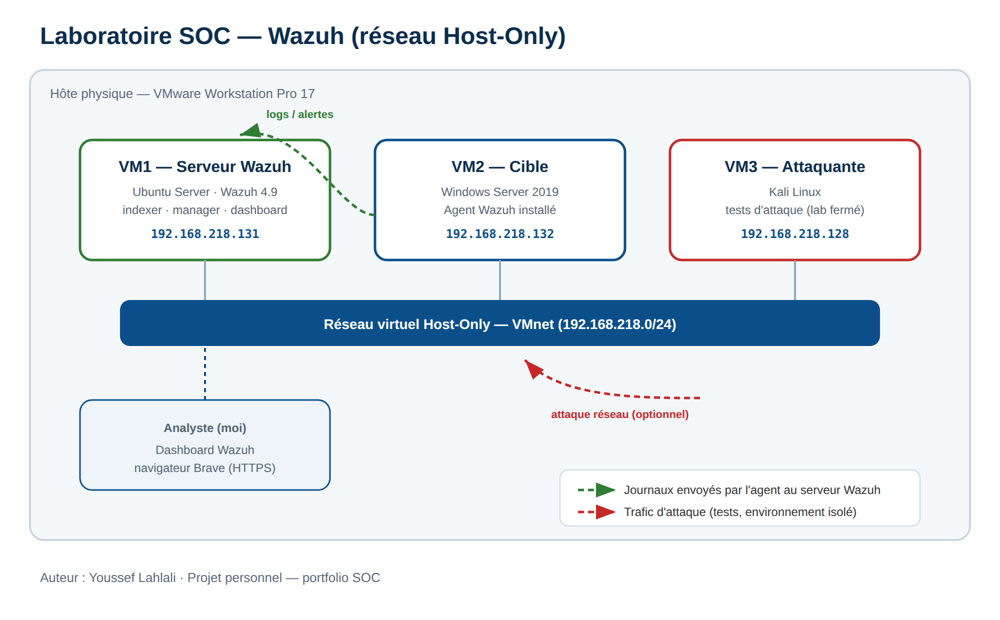

# SOC Home Lab — Wazuh (SIEM)

> 🇬🇧 [English](#-english) · 🇫🇷 [Français](#-français)

A home lab where I deployed the Wazuh SIEM, generated attacker-style activity on a Windows machine, analyzed the alerts, and wrote my own PowerShell monitoring script that reports back into the SIEM.

---

## 🇬🇧 English

### About me
My name is Youssef. I study at Cégep de Saint-Hyacinthe (DEC in IT / networking and cybersecurity) and I am aiming for a career in cybersecurity (SOC). I learn fast and I like to really understand how things work, so I built this lab on my own to practice outside of class.

### Goal of the project
- Deploy a SIEM (Wazuh) to collect and analyze the security logs of a Windows machine.
- Simulate malicious actions (failed logons, admin account creation, persistence) and confirm that Wazuh detects them.
- Write my own PowerShell monitoring script and connect it to Wazuh.

### Lab architecture
| Machine | Role | OS |
|---|---|---|
| VM1 | Wazuh server (indexer, manager, dashboard) | Ubuntu Server |
| VM2 | Target / monitored host (agent) | Windows |
| VM3 | Attacker machine | Kali Linux |

> Hypervisor: VMware Workstation Pro 17. All machines are on the same isolated network.

### What I did
**1. Wazuh deployment** — installed the indexer, manager and dashboard on Ubuntu with the official script.

**2. Windows agent** — installed the agent on the Windows host and confirmed the connection to the manager (log: `Connected to the server`).

**3. Detection tests** — on the monitored host, I generated three types of activity and confirmed each one in the dashboard:

| Test | Action | Wazuh rule | MITRE ATT&CK |
|---|---|---|---|
| A | Repeated failed logons (brute-force style) | 60122 | T1110 – Brute Force |
| B | Create a local account and add it to Administrators | 60154 (level 12) | T1136 / T1098 |
| C | Drop a file in the Startup folder (persistence) | 554 (FIM) | T1547 |

**4. Monitoring script** — I wrote a PowerShell script that checks services, disk space, CPU/memory and system errors, builds an HTML report, and writes an event to the Windows log. Wazuh picks it up (rule 60602). I also scheduled it to run every hour.

### Tools and skills
`Wazuh (SIEM)` · `VMware` · `Windows` · `Ubuntu Server` · `PowerShell` · `Active Directory basics` · `MITRE ATT&CK` · `log analysis` · `incident triage`

### What I learned
- The role of each Wazuh component (indexer, manager, dashboard, agent).
- How to read a log to fix a service that will not start.
- How to analyze an alert (rule, level, Windows event ID) and map it to MITRE ATT&CK.

### Next steps
- Add my own custom detection rule in Wazuh.
- Test the lab with network attacks from the Kali machine, in an isolated environment.

### Screenshots
See the `/screenshots` folder. Full step-by-step documentation is in `/docs`.

---

## 🇫🇷 Français

### À propos de moi
Je m'appelle Youssef. J'étudie au Cégep de Saint-Hyacinthe (DEC en informatique / réseaux et cybersécurité) et je vise une carrière en cybersécurité (SOC). J'apprends vite et j'aime vraiment comprendre comment les choses fonctionnent, alors j'ai monté ce laboratoire par moi-même pour pratiquer en dehors des cours.

### Objectif du projet
- Déployer un SIEM (Wazuh) pour collecter et analyser les journaux de sécurité d'un poste Windows.
- Simuler des actions malveillantes (échecs de connexion, création d'un compte administrateur, persistance) et confirmer que Wazuh les détecte.
- Écrire mon propre script de surveillance PowerShell et l'intégrer à Wazuh.

### Architecture du laboratoire
| Machine | Rôle | OS |
|---|---|---|
| VM1 | Serveur Wazuh (indexer, manager, dashboard) | Ubuntu Server |
| VM2 | Cible / poste surveillé (agent) | Windows |
| VM3 | Machine attaquante | Kali Linux |

> Hyperviseur : VMware Workstation Pro 17. Toutes les machines sont sur le même réseau isolé.

### Ce que j'ai fait
**1. Déploiement de Wazuh** — installation de l'indexer, du manager et du dashboard sur Ubuntu avec le script officiel.

**2. Agent Windows** — installation de l'agent sur le poste Windows et vérification de la connexion au manager (log : `Connected to the server`).

**3. Tests de détection** — sur le poste surveillé, j'ai généré trois types d'activité et confirmé chacune dans le dashboard :

| Test | Action | Règle Wazuh | MITRE ATT&CK |
|---|---|---|---|
| A | Échecs de connexion répétés (style force brute) | 60122 | T1110 – Brute Force |
| B | Créer un compte local et l'ajouter aux Administrateurs | 60154 (niveau 12) | T1136 / T1098 |
| C | Déposer un fichier dans le dossier de démarrage (persistance) | 554 (FIM) | T1547 |

**4. Script de surveillance** — j'ai écrit un script PowerShell qui vérifie les services, l'espace disque, le CPU/mémoire et les erreurs système, qui produit un rapport HTML et qui écrit un événement dans le journal Windows. Wazuh le récupère (règle 60602). Je l'ai aussi planifié pour qu'il tourne toutes les heures.

### Outils et compétences
`Wazuh (SIEM)` · `VMware` · `Windows` · `Ubuntu Server` · `PowerShell` · `bases Active Directory` · `MITRE ATT&CK` · `analyse de logs` · `triage d'incidents`

### Ce que j'ai appris
- Le rôle de chaque composant de Wazuh (indexer, manager, dashboard, agent).
- Lire un log pour régler un service qui ne démarre pas.
- Analyser une alerte (règle, niveau, event ID Windows) et faire le lien avec MITRE ATT&CK.

### Prochaines étapes
- Ajouter ma propre règle de détection personnalisée dans Wazuh.
- Tester le lab avec des attaques réseau depuis la machine Kali, dans un environnement isolé.

### Captures d'écran
Voir le dossier `/screenshots`. La documentation complète étape par étape est dans `/docs`.

